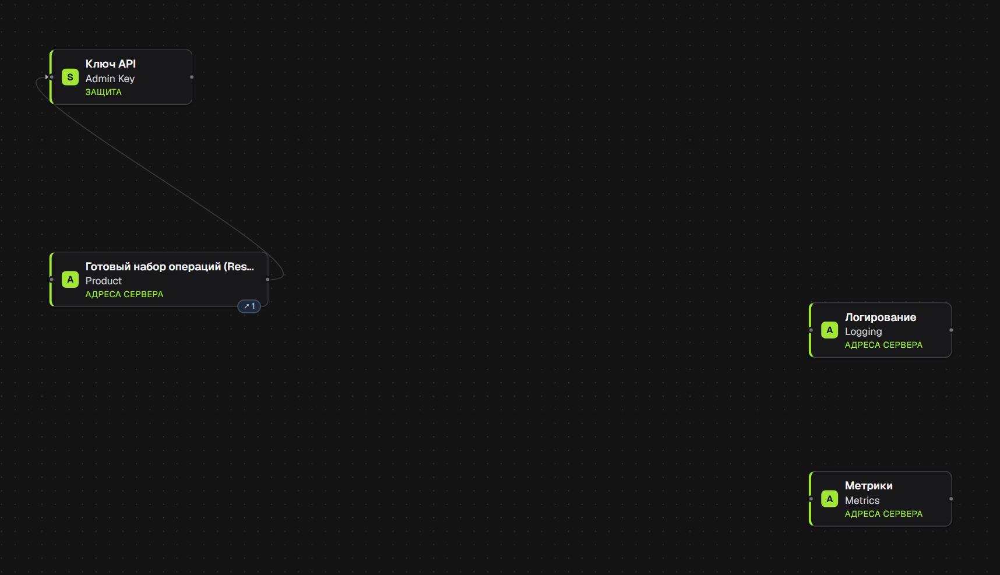
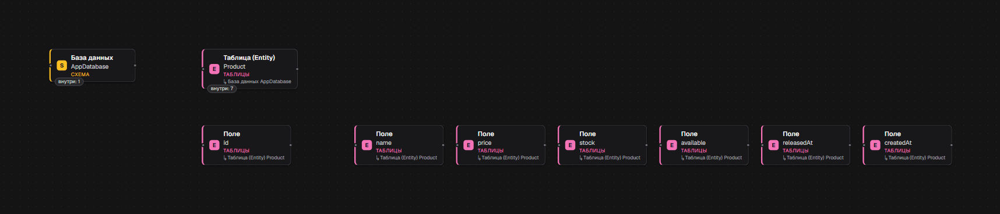

# Shop API

Образец проекта, сгенерированного в FxM Engine. Код после генерации не правился. Репозиторий нужен, чтобы оценить код до регистрации и оплаты.

> Собрано в [FxM Engine](https://engine.fxm-int.space). В «Новом проекте» есть галерея из 27 готовых заготовок: сайты, магазины, запись и бронирование, боты, системы для бизнеса. Из любой можно начать свой проект и забрать код в Git.

**Что внутри:** Next.js + NestJS + Prisma + PostgreSQL. Ресурс Product с полями разных типов (строка, дробное, целое, boolean, дата): сайт, API, Docker. Правила в блоках, а не в коде:

- Проверка полей: название от 2 символов, цена и остаток не меньше нуля.
- Готовые фильтры списка: `GET /products?query=available` (в продаже, по названию) и `out` (остаток 0).
- Журнал запросов: сервер пишет по строке JSON на каждый запрос в стандартный вывод (`LOG_LEVEL` задаёт уровень).
- Метрики запросов на `/metrics` (нужен `METRICS_TOKEN`).

**Что проверено**

- `cd backend && npm install && npm test`: 16 тестов: 8 проверяют сервис ресурса на in-memory репозитории (создание, список, чтение, изменение, удаление, 404), 4 проверяют разбор параметров списка, 4 проверяют правила полей: запрос, который нарушает правило, отказан (422), и ничего не сохранено. База данных не нужна, все проходят.
- **На настоящей базе** (PostgreSQL 16 в Docker, собранный сервер, 9 проверок скриптом по HTTP; скрипта в репозитории нет): отрицательная цена, отрицательный остаток и название в одну букву отказаны, хорошие товары создаются, фильтры `available` и `out` разделяют их верно, `/metrics` без токена отказан и отвечает с токеном, в журнале запросов по строке на запрос.
- Сайт собирается (`next build`). Страницы в браузере не открывались.
- GitHub Actions (`.github/workflows/build-pipeline.yml`) собирает и тестирует проект на каждый push в `main`.

**Чего здесь нет (честно)**

- Тесты сайта (Playwright, одна страница, запущен: 1 из 1) только открывают страницу и проверяют её содержимое; в CI для них есть шаг с установкой Chromium. Тестов с настоящей базой данных и HTTP-слоем в репозитории нет.
- Это не магазин: нет заказов, корзины, оплаты и списания остатка (в Engine для этого есть блок Stock, здесь он не используется).
- Нет входа пользователей: сайт показывает и добавляет только то, что открыто всем; защищённые маршруты требуют общий ключ.
- Файл `*.hooks.ts` создан пустым: в нём пишется ваш код вокруг вызовов сервиса, и повторная генерация его не перезаписывает.

---

# Shop API

Сгенерировано в FxM Engine. Проект можно открыть в любой IDE, положить в Git и развивать дальше без FxM Engine.

## Части проекта

- База данных
- Сервер
- Сайт
- Сборка и выпуск (CI/CD)

## Из каких блоков собрано

Снимки холстов Engine, снятые с `project.json` из этого репозитория. Код получен из этих блоков нажатием «Сгенерировать». У проекта есть ещё холст сайта (десять блоков); здесь показаны сервер и база.

**Сервер:** блок «Готовый набор операций (Resource)» `Product` — весь API товаров; «Ключ API» `Admin Key`, который закрывает маршруты записи; «Логирование» — журнал запросов; «Метрики» — `/metrics`.

**База данных:** таблица `Product` с полями `id`, `name`, `price`, `stock`, `available`, `releasedAt`, `createdAt`.

## Запуск

1. Установите [Docker Desktop](https://www.docker.com/products/docker-desktop/) (бесплатно) и запустите его.
2. Откройте терминал в этой папке.
3. Скопируйте `backend/.env.example` в `backend/.env` и заполните то, что нужно вашему проекту: ключи сервисов, которыми вы пользуетесь (например, ключ провайдера ИИ), и секреты, которые вы придумываете сами (любой длинный случайный текст). Пустые переменные необязательны. Без `backend/.env` проект всё равно запустится, но возможности, которым нужен ключ или секрет, останутся выключены. Исключение — ключи, защищающие ваши маршруты (`ADMIN_KEY`): защищённый маршрут никого не пускает, пока его ключ не станет длинным случайным текстом, который вы придумали сами; вызывающий затем передаёт тот же текст в заголовке `x-api-key`. Веб-страница такой ключ не несёт, поэтому без него сайт показывает и добавляет только то, что в проекте открыто для всех.
4. Выполните `docker compose up --build`. Первый запуск занимает несколько минут.
5. Откройте http://localhost:3000 для сайта; сервер отвечает на http://localhost:3001.
6. Остановить можно `Ctrl+C` в терминале; `docker compose up` запустит всё снова с сохранёнными данными.

## Если что-то не работает

Выполните `docker compose logs`, чтобы увидеть, что пошло не так. Строка вроде `request failed: 401` от подключённого сервиса означает, что его ключ в `backend/.env` не задан или неверен; исправьте его и выполните `docker compose up -d` снова.
